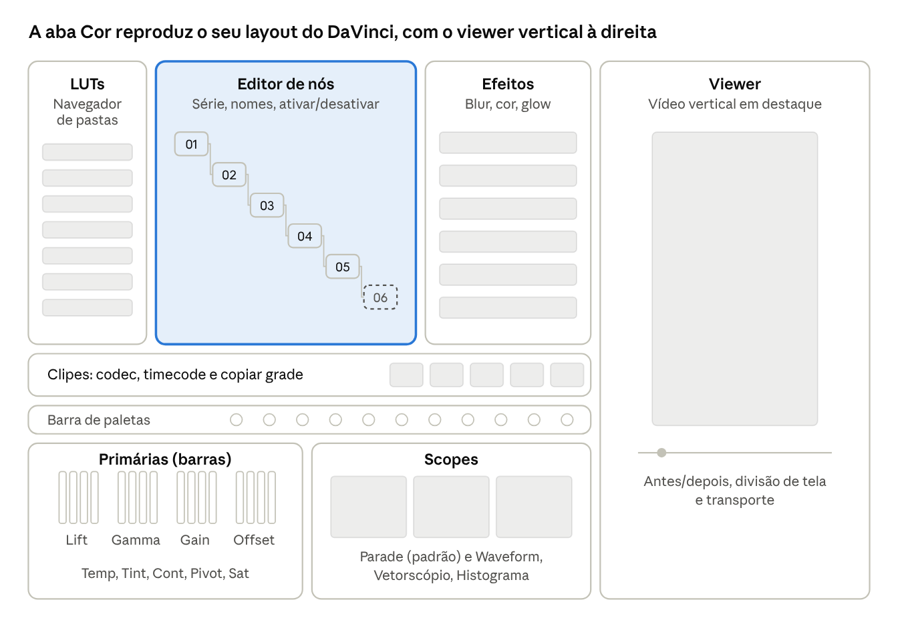

# KODA Pro — especificação da aba Cor v1

15/10/2026 · Cleyson

> Versão editável deste documento: https://claude.ai/code/artifact/492ce55c-8fbc-491d-a274-e6f7201a6b09

A aba Cor v1 está pronta quando o powergrade KODA (6 nós em série), aplicado num bruto S-Log3 da FX30, dá a mesma imagem que no DaVinci, tocando liso em 4K 10-bit.

## Objetivo

O fluxo de cor de hoje é um powergrade fixo, ajustado em cada projeto para manter a identidade visual. A v1 reproduz exatamente esse fluxo, do jeito que ele é usado: aplicar o powergrade, ajustar os nós, copiar para os outros clipes e exportar. O resto do DaVinci entra nas versões seguintes.

## O powergrade de referência

São 6 nós em série, e a ordem importa: o ajuste global acontece ainda em log, antes do CST. Cada nó processa a imagem no espaço de cor em que ela está naquele ponto da cadeia.

| Nó | Nome | O que faz | Espaço de cor na entrada | O que o KODA Pro precisa |
| --- | --- | --- | --- | --- |
| 01 | global | Rodas e curvas (primárias) | S-Log3 / S-Gamut3.Cine | Nó de correção com rodas, curvas e ajustes primários |
| 02 | CST | Color Space Transform | S-Log3 / S-Gamut3.Cine | Transformação S-Gamut3.Cine/S-Log3 → Rec.709 Gamma 2.4, com tone mapping e gamut mapping |
| 03 | nitidez | Nitidez/desfoque | Rec.709 | Nitidez e desfoque por nó |
| 04 | glow | Resolve FX Glow | Rec.709 | Glow com estilo de composição Soft Light, ganho geral e highlight recovery |
| 05 | LUT | LUT criativa (.cube) | Rec.709 | Nó de LUT 3D |
| 06 | LUT | LUT reserva, desativada | Rec.709 | Ativar e desativar nó sem apagar |

## Escopo da v1

A v1 cobre tudo que o powergrade usa, mais o necessário para trabalhar com ele no dia a dia.

| Área | O que entra na v1 |
| --- | --- |
| Editor de nós | Nós em série com miniatura, número e nome editável; adicionar, apagar, reordenar; ativar/desativar nó (atalho) e desativar a grade inteira (bypass); biblioteca de efeitos ao lado, para arrastar blur, cor e glow para um nó |
| Primárias | Lift, Gamma, Gain e Offset nos dois modos do DaVinci, barras (Color Bars, o modo usado hoje) e rodas; Temp, Tint, Contraste, Pivot, Mid Detail, Color Boost, Shadows, Highlights, Saturação, Hue e Lum Mix; campos numéricos editáveis em todas |
| Curvas | Curvas personalizadas Y/R/G/B com pontos, ligação de canais e reset |
| CST | Entrada e saída de espaço de cor e gamma; tone mapping e gamut mapping; presets S-Log3/S-Gamut3.Cine e Rec.709 2.4 |
| Nitidez | Nitidez e desfoque com raio e intensidade |
| Glow | Limiar e faixa do brilho, espalhamento, ganho, highlight recovery e estilo de composição (Soft Light, Screen, Add, Normal) |
| LUT | Carregar .cube 3D (e 1D), intensidade da LUT; navegador de LUTs em pastas, com pré-visualização ao passar o mouse e arrastar a LUT para um nó |
| Scopes | Waveform, Parade RGB (padrão), Vetorscópio e Histograma, ao vivo, com escala de 10 bits (0 a 1023) |
| Powergrades | Biblioteca de powergrades: salvar a árvore inteira, aplicar num clipe, copiar grade de um clipe para outros, colar só um nó |
| Visualização | Antes/depois (bypass), divisão de tela, isolar a saída de um nó |
| Precisão | Processamento em ponto flutuante 32 bits em toda a cadeia, sem cortar valores entre nós |

Os nomes dos parâmetros do glow seguem o Resolve FX Glow. Os mais usados são o estilo Soft Light, o ganho geral e o highlight recovery, e os valores-padrão devem dar a mesma imagem que o DaVinci.

## A tela

A aba Cor reproduz o layout que o dono usa hoje no DaVinci (print de 15/10), para não exigir reaprender nada. A organização e o comportamento seguem o DaVinci; os ícones e elementos gráficos são próprios, no visual KODA (minimalista, preto, branco e verde), porque os do DaVinci pertencem à Blackmagic.

O viewer ocupa a altura toda à direita, por causa do vídeo vertical. À esquerda, no alto, ficam o navegador de LUTs, o editor de nós (o nó 06 tracejado está desativado) e a biblioteca de efeitos. Abaixo vêm a faixa de clipes (com codec e timecode de cada clipe), a barra de paletas, as primárias em modo barras e os scopes em Parade. A biblioteca de powergrades abre no lugar do navegador de LUTs, como a Gallery do DaVinci. Os painéis são encaixáveis: dá para rearranjar e salvar o layout sem mexer em código.

## Arquitetura

Boa parte da ciência de cor já existe no FilmCraft. O trabalho novo da v1 está em três pontos: o motor de nós, o glow e a tela.

| Peça | Já existe no FilmCraft | O que falta |
| --- | --- | --- |
| S-Log3 / S-Gamut3.Cine → Rec.709 | Curvas de log, matrizes de gamut, tone mapping BT.2390 e compressão de gamut (`crates/color`) | Expor como um nó CST com entrada/saída configuráveis e conferir contra o CST do DaVinci |
| LUT | Leitura de .cube 1D/3D com interpolação tetraédrica (`color/lut`), LUT na GPU (`gpu/lut`) | Nó de LUT com intensidade |
| Nitidez | Unsharp mask na GPU (`render/gpufx`, efeito `sharpen`) | Nó de nitidez/desfoque |
| Primárias | Lumetri básico na GPU; rodas e curvas do Lumetri rodam na CPU | Rodas Lift/Gamma/Gain/Offset e curvas na GPU, com a matemática do DaVinci |
| Glow | Não existe | Efeito novo na GPU: isolar brilho, desfocar em várias escalas e compor (Soft Light, Screen, Add, Normal) |
| Scopes | Waveform, Parade, Vetorscópio e Histograma (`crates/scopes`) | Painel ao vivo na aba Cor, calculado na GPU |
| Copiar grade | Colar atributos entre clipes (`edit.pasteAttributes`) | Biblioteca de powergrades e cópia da árvore inteira |

**Onde o código mora.** Tudo que é nosso fica num módulo novo, `crates/koda-color`, mexendo o mínimo no código do FilmCraft. Para isso funcionar, o FilmCraft precisa de um ponto de encaixe para efeitos de cor (um gancho no compositor), e esse ponto pode ser enviado de volta ao projeto original.

**Modelo de dados.** Cada clipe ganha uma grade: uma lista ordenada de nós, cada nó com tipo, nome, ativado/desativado e parâmetros. A grade é salva no arquivo do projeto, em texto legível. Um powergrade é essa mesma lista salva num arquivo próprio na biblioteca do usuário.

**GPU.** A cadeia inteira de nós roda num único passe de GPU (Metal, via wgpu), em ponto flutuante 32 bits, sem cortar valores entre nós. A versão na CPU continua existindo só como referência nos testes, seguindo a regra do FilmCraft (a CPU é o oráculo, a GPU é o caminho rápido).

**Comandos e MCP.** Toda ação da aba vira um comando com id e parâmetros (por exemplo `koda.color.addNode`, `koda.color.setWheel`, `koda.color.applyPowergrade`). Assim a tela, o Claude via MCP e o desfazer usam o mesmo caminho, e o Claude consegue colorir ou aplicar o powergrade num projeto inteiro.

## Ordem de construção

Cada marco termina com algo que dá para ver funcionando, e só começa depois que a Etapa 1 (base com os arquivos da FX30) estiver fechada.

1. **Motor de nós:** modelo de dados da grade, comandos, salvar no projeto e cadeia de nós na GPU com um nó simples (ganho). Teste: o resultado na GPU bate com a referência na CPU.
2. **CST e LUT:** nós de CST e LUT ligados ao que já existe. Teste: S-Log3 → Rec.709 e a LUT do nó 05 batem com os frames exportados do DaVinci.
3. **Primárias e curvas na GPU:** barras/rodas, ajustes primários e curvas. Teste: valores iguais aos do DaVinci dão a mesma imagem.
4. **Nitidez e glow:** nó de nitidez com o efeito existente e o glow novo, com estilo Soft Light, ganho e highlight recovery. Teste: o powergrade inteiro bate com o DaVinci.
5. **Tela da aba Cor:** layout da seção "A tela", com editor de nós, primárias, curvas, navegador de LUTs, biblioteca de efeitos e scopes ao vivo.
6. **Powergrades:** biblioteca, aplicar, copiar entre clipes e colar um nó. Teste: aplicar o powergrade KODA em 10 clipes e exportar.
7. **Desempenho e polimento:** 4K 10-bit tocando liso com os 6 nós, atalhos e ajustes finos da tela.

## Testes e critérios de pronto

A referência de "ficou igual" é o próprio DaVinci: os mesmos frames, exportados de lá e do KODA Pro, comparados número a número.

| Teste | Como é feito | Critério de pronto |
| --- | --- | --- |
| Fidelidade por nó | Para cada nó do powergrade, exportar do DaVinci o frame com a cadeia até aquele nó, e comparar com o KODA Pro | Diferença de cor média (ΔE 2000) abaixo de 1 e máxima abaixo de 3, ou seja, invisível a olho |
| Powergrade inteiro | Mesmo bruto S-Log3 da FX30 com os 6 nós, no DaVinci e no KODA Pro | Mesmo critério acima, conferido também lado a lado na tela |
| GPU contra CPU | Cada nó calculado nos dois caminhos | Resultados iguais dentro da tolerância dos testes do FilmCraft |
| Desempenho | Clipe 4K 10-bit 4:2:2 da FX30 com os 6 nós, preview em 1/2 e cheio | Menos de 1% de quadros perdidos em 1/2; medir e registrar em cheio |
| Export | Exportar 30 s com o powergrade em H.264 e ProRes 422 | Mesma imagem do preview, croma 4:2:2 preservado no ProRes |
| Ida e volta | Salvar o projeto e o powergrade, fechar e reabrir | Grade idêntica, nada perdido |

## Fora da v1

O objetivo é chegar o mais perto possível do DaVinci, em fases. O que não está no powergrade fica para depois.

| Versão | O que entra |
| --- | --- |
| v2 | Nós em paralelo e layer (com modos de mistura), curvas Hue vs Hue/Sat/Lum e Lum vs Sat, qualifier HSL com refinamento de máscara, power windows (círculo, retângulo, polígono, curva) com suavização, nós de saída de máscara (key) |
| v3 | Tracking das windows, gerenciamento de cor do projeto (DaVinci Wide Gamut e ACES), galeria de stills e comparação com wipe, mais efeitos (grain de filme, halation, desfoque de lente), color match entre clipes, grade de grupo e de timeline |

## Pendências

Antes de começar, faltam os arquivos de referência do DaVinci, em `docs/koda/cor/referencia/`.

- [ ] Fechar a Etapa 1 (arquivos da FX30 rodando liso e export mantendo 4:2:2)
- [ ] Exportar do DaVinci o powergrade KODA (.drx) e anotar os valores de cada nó
- [ ] Exportar um frame em log sem correção e o mesmo frame depois de cada nó (01 a 05), em TIFF 16 bits
- [ ] Copiar a LUT .cube do nó 05 para a pasta de referência
- [ ] Anotar os parâmetros do glow (estilo Soft Light, ganho, highlight recovery e os demais)
- [ ] Copiar o bruto S-Log3 da FX30 usado nos frames
